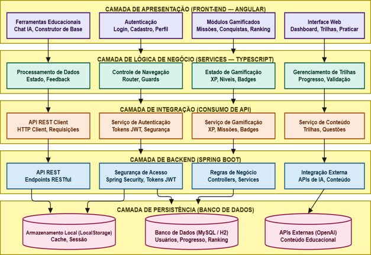
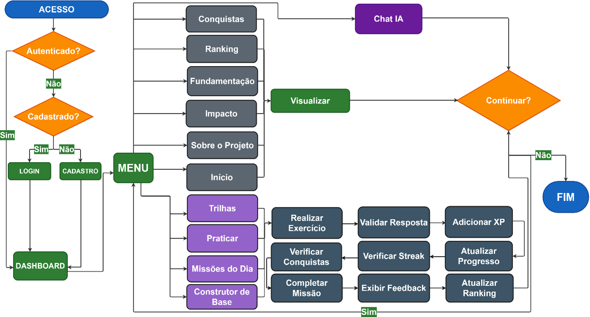

<!-- ============================================================================
     VÍDEO DE DEMONSTRAÇÃO
     O vídeo de demonstração (interação com a plataforma) será salvo em
     frontend/imagens/. Ao receber o arquivo, adicione-o nessa pasta e ajuste
     o link da seção "2. Demonstração".
============================================================================ -->

<!-- Tema visual do README (aplicado no preview do VS Code; o GitHub ignora este bloco). -->
<style>
  body {
    background: #f0f4ff !important;
    color: #1a1a2e;
    font-family: 'Inter', 'Roboto', 'Helvetica Neue', sans-serif;
    line-height: 1.7;
  }

  h2 {
    position: relative !important;
    font-size: 1.5em !important;
    font-weight: 800 !important;
    color: #0f1a5c !important;
    margin-top: 2.4em !important;
    padding-bottom: 0.5em !important;
    border-bottom: 1px solid #e2e8f0 !important;
  }

  h2::after {
    content: "" !important;
    position: absolute !important;
    left: 0 !important;
    bottom: -1px !important;
    width: 72px !important;
    height: 3px !important;
    border-radius: 3px !important;
    background: linear-gradient(90deg, #1a2980, #26d0ce) !important;
  }

  h3 {
    font-size: 1.12em !important;
    font-weight: 650 !important;
    color: #1a2980 !important;
    margin-top: 1.8em !important;
  }

  a { color: #1a2980 !important; text-decoration: none !important; }
  a:hover { color: #26d0ce !important; text-decoration: underline !important; }

  table {
    border-collapse: separate !important;
    border-spacing: 0 !important;
    width: 100% !important;
    background: #ffffff !important;
    border: 1px solid #e2e8f0 !important;
    border-radius: 16px !important;
    overflow: hidden !important;
    box-shadow: 0 4px 20px rgba(26, 41, 128, 0.08) !important;
  }

  th {
    background: linear-gradient(135deg, #1a2980, #26d0ce) !important;
    color: #ffffff !important;
    font-weight: 600 !important;
    text-align: left !important;
    padding: 11px 14px !important;
    border: none !important;
  }

  td {
    padding: 10px 14px !important;
    border-top: 1px solid #e2e8f0 !important;
    vertical-align: top !important;
  }

  tbody tr:nth-child(even) { background: #f8faff !important; }
  tbody tr:hover { background: #eef3ff !important; }

  code {
    background: #1a2980 !important;
    color: #ffffff !important;
    padding: 2px 6px !important;
    border-radius: 6px !important;
    font-family: ui-monospace, SFMono-Regular, "SF Mono", Menlo, Consolas, monospace !important;
    font-size: 0.92em !important;
  }

  pre {
    background: #0f1a5c !important;
    padding: 16px 18px !important;
    border-radius: 12px !important;
    overflow-x: auto !important;
    border: none !important;
  }

  pre code {
    background: transparent !important;
    color: #dbeafe !important;
    padding: 0 !important;
    border-radius: 0 !important;
    font-size: 0.9em !important;
  }

  blockquote {
    border-left: 4px solid #26d0ce !important;
    background: #eef2ff !important;
    padding: 12px 18px !important;
    border-radius: 0 10px 10px 0 !important;
    color: #1a1a2e !important;
    margin: 1.2em 0 !important;
  }

  hr {
    border: none !important;
    height: 1px !important;
    background: linear-gradient(90deg, transparent, #26d0ce, transparent) !important;
    margin: 2.6em 0 !important;
  }

  ul, ol { padding-left: 1.5em !important; }
  li { margin: 0.35em 0 !important; }
  li::marker { color: #26d0ce !important; }

  .orb {
    position: absolute;
    border-radius: 50%;
    pointer-events: none;
  }
  .orb-1 {
    width: 500px;
    height: 500px;
    top: -150px;
    right: -100px;
    background: rgba(255, 255, 255, 0.04);
    animation: float 8s ease-in-out infinite;
  }
  .orb-2 {
    width: 300px;
    height: 300px;
    bottom: -100px;
    left: 5%;
    background: rgba(38, 208, 206, 0.08);
    animation: float 10s ease-in-out infinite reverse;
  }
  .orb-3 {
    width: 200px;
    height: 200px;
    top: 30%;
    right: 25%;
    background: rgba(245, 166, 35, 0.06);
    animation: float 12s ease-in-out infinite;
  }
  @keyframes float {
    0%, 100% { transform: translateY(0) rotate(0deg); }
    50% { transform: translateY(-20px) rotate(5deg); }
  }
</style>

<div align="center" style="position:relative;overflow:hidden;padding:48px 24px;border-radius:24px;background:linear-gradient(135deg,#1a2980 0%,#26d0ce 100%);">

<div class="orb orb-1"></div>
<div class="orb orb-2"></div>
<div class="orb orb-3"></div>

<div style="position:relative;z-index:2;">
<p style="display:inline-flex;align-items:center;gap:8px;background:rgba(255,255,255,0.12);border:1px solid rgba(255,255,255,0.25);border-radius:30px;padding:8px 18px;color:#ffffff;font-size:13px;font-weight:600;margin:0 0 24px;">🎓 Plataforma gamificada para graduandos</p>

<h1 style="color:#ffffff;font-size:2.8em;font-weight:900;letter-spacing:-0.03em;margin:0.1em 0;">📖 RevisaLab</h1>

<p style="font-size:1.15em;color:rgba(255,255,255,0.92);margin:0.4em 0;">
  <strong>Plataforma de estudos gamificada</strong> para o nivelamento e a revisão estruturada de conteúdos do ensino médio.
</p>

<p style="color:rgba(255,255,255,0.75);margin:0;">
  <em>Trabalho de Conclusão de Curso (TCC) · Engenharia de Software</em>
</p>

<p style="margin-top:20px;">
  
  
  
  
  
</p>

<p>
  
  
  
  
  
  
</p>

<p style="margin-bottom:4px;">
  
  
</p>
</div>

</div>

---

## Sumário

1. [Contexto e objetivo](#1-contexto-e-objetivo)
2. [Demonstração](#2-demonstração)
3. [Arquitetura e funcionamento](#3-arquitetura-e-funcionamento)
   - [3.1 Arquitetura em camadas](#31-arquitetura-em-camadas)
   - [3.2 Fluxo de interação e gamificação](#32-fluxo-de-interação-e-gamificação)
   - [3.3 Stack tecnológica](#33-stack-tecnológica)
   - [3.4 Estrutura do repositório](#34-estrutura-do-repositório)
4. [Funcionalidades](#4-funcionalidades)
   - [4.1 Funcionalidades e requisitos funcionais](#41-funcionalidades-e-requisitos-funcionais)
   - [4.2 Requisitos não funcionais](#42-requisitos-não-funcionais)
5. [Execução](#5-execução)
   - [5.1 Pré-requisitos](#51-pré-requisitos)
   - [5.2 Backend (API)](#52-backend-api)
   - [5.3 Frontend (SPA)](#53-frontend-spa)
   - [5.4 Variáveis de ambiente](#54-variáveis-de-ambiente)
   - [5.5 Credenciais de teste](#55-credenciais-de-teste)
   - [5.6 Rotas da aplicação](#56-rotas-da-aplicação)
6. [Aspectos técnicos](#6-aspectos-técnicos)
   - [6.1 Integrações externas](#61-integrações-externas)
   - [6.2 Banco de dados](#62-banco-de-dados)
   - [6.3 Segurança](#63-segurança)
7. [Validação](#7-validação)
8. [Limitações e trabalhos futuros](#8-limitações-e-trabalhos-futuros)
9. [Repositório GitHub](#9-repositório-github)

[Licença](#licença)

---

## 1. Contexto e objetivo

O **RevisaLab** é uma plataforma web gamificada que apoia a **revisão estruturada de conteúdos do ensino médio**, atuando como complemento à formação do graduando. Ela organiza recursos educacionais em **trilhas de aprendizagem** e integra mecânicas de jogo — pontos (**XP**), níveis, conquistas, ranking, missões e feedback imediato — para ampliar o engajamento, a autonomia e o acompanhamento contínuo do progresso do estudante.

O protótipo combina front-end em **Angular** e back-end em **Java (Spring Boot)**, cobrindo os requisitos funcionais e não funcionais detalhados na seção [4. Funcionalidades](#4-funcionalidades).

---

## 2. Demonstração

<!-- VÍDEO: salve o arquivo em frontend/imagens/ e troque "demonstracao.mp4" no link abaixo. -->
<p align="center"><a href="frontend/imagens/demonstracao.mp4"> Assistir à demonstração do RevisaLab</a> — <em>vídeo a ser adicionado.</em></p>
<!-- FIM DO VÍDEO -->

---

## 3. Arquitetura e funcionamento

### 3.1 Arquitetura em camadas

A aplicação segue o paradigma **cliente-servidor** em cinco camadas:

| Camada | Responsabilidade |
|--------|------------------|
|  Apresentação | Angular/TypeScript — Home, Dashboard, Trilhas, Praticar (Quiz), Missões, Conquistas, Ranking, Chat IA, Construtor de Base, Fundamentação, Impacto, Sobre e Perfil |
|  Lógica de negócio | Services TypeScript — navegação, gamificação e validações |
|  Serviços de integração | Autenticação JWT e gerenciamento de conteúdo |
|  Backend | Spring Boot — API REST, Spring Security e integração com APIs externas |
|  Persistência | MySQL/H2 — usuários, progresso, pontuação e conquistas |

<p align="center">
  
  <br><em>Figura 1 – Arquitetura em camadas do sistema RevisaLab.</em>
</p>

### 3.2 Fluxo de interação e gamificação

O fluxo inicia-se no acesso à plataforma, com **autenticação ou cadastro** do estudante. No **Dashboard**, ele acompanha o progresso geral e escolhe a próxima atividade. Ao responder exercícios, o sistema **valida a resposta, adiciona XP, atualiza o progresso, verifica o streak diário, desbloqueia conquistas, conclui missões, exibe feedback detalhado e atualiza o ranking** — um ciclo de resposta → recompensa → progresso que se repete a cada interação e reforça o engajamento.

<p align="center">
  
  <br><em>Figura 2 – Fluxograma de interação e gamificação.</em>
</p>

### 3.3 Stack tecnológica

| Camada | Tecnologias |
|--------|-------------|
| Backend | Java 21, Spring Boot 3.4.1, Spring Security (JWT), Spring Data JPA, Lombok, ModelMapper, SpringDoc OpenAPI |
| Frontend | Angular 21, TypeScript 5.9, RxJS 7, Angular Material, Bootstrap 5, ngx-toastr |
| Banco de dados | H2 (desenvolvimento) / MySQL (produção) |

### 3.4 Estrutura do repositório

```
RevisaLab/
├── backend/              # API REST em Spring Boot (Java 21)
│   └── src/main/
│       ├── java/com/revisalab/
│       │   ├── config/       # Configurações (CORS, OpenAPI)
│       │   ├── controller/   # Endpoints REST
│       │   ├── dto/          # Objetos de transferência (request/response)
│       │   ├── enums/        # Enumerações
│       │   ├── exception/    # Tratamento de erros
│       │   ├── mapper/       # Conversores entidade/DTO
│       │   ├── model/        # Entidades JPA
│       │   ├── repository/   # Acesso a dados
│       │   ├── security/     # JWT, filtros e autorização
│       │   └── service/      # Regras de negócio
│       └── resources/        # application.yml e dados iniciais
├── frontend/             # SPA em Angular 21
│   ├── src/app/
│       ├── auth/            # Login e cadastro
│       ├── dashboard/       # Painel principal
│       ├── aulas/           # Trilhas de aprendizagem
│       ├── quiz/            # Praticar (exercícios)
│       ├── construtor-base/ # Construtor de Base
│       ├── chat/            # Chat IA
│       ├── missoes/         # Missões
│       ├── biblioteca/      # Conquistas
│       ├── ranking/         # Ranking
│       ├── relatorios/      # Desempenho
│       ├── perfil/          # Perfil do usuário
│       ├── feedback/        # Feedback
│       ├── home/            # Landing page
│       ├── sobre/ · fundamentacao/ · impacto/   # Páginas públicas
│       └── services/        # Integração com a API
│   └── imagens/           # Diagramas e imagens do projeto (Figuras 1 e 2)
├── proposta.txt          # Documento da proposta (TCC)
└── README.md             # Este arquivo
```

---

## 4. Funcionalidades

### 4.1 Funcionalidades e requisitos funcionais

A tabela consolida as funcionalidades implementadas e o atendimento aos requisitos funcionais (RF) definidos na proposta.

| RF | Funcionalidade | Descrição | Status |
|:--:|----------------|-----------|:------:|
| RF01 | Autenticação | Cadastro, login e recuperação de senha com tokens JWT e senhas criptografadas (BCrypt). | Atendido |
| RF02 | Trilhas | Trilhas de aprendizagem por disciplina, organizadas em módulos e etapas. | Atendido |
| RF03 | Pontuação e XP | Sistema de pontos com XP, níveis e streak diário, atualizados a cada atividade. | Atendido |
| RF04 | Níveis e conquistas | Badges desbloqueados por marcos de desempenho. | Atendido |
| RF05 | Ranking | Classificação de estudantes por XP acumulado. | Atendido |
| RF06 | Dashboard | Painel com XP, nível, streak, progresso e ranking semanal. | Atendido |
| RF07 | Praticar (Quiz) | Exercícios interativos com feedback imediato e explicação dos conceitos. | Atendido |
| RF08 | Missões | Missões diárias, semanais e pessoais (criar, concluir e excluir). | Atendido |
| RF09 | Chat IA | Assistente inteligente integrado à API Groq para suporte ao estudo. | Atendido |
| RF10 | Construtor de Base | Prática de fundamentos em que cada acerto adiciona um bloco à base construída. | Atendido |
| RF11 | Fundamentação | Módulo público de fundamentação teórica do trabalho. | Atendido |
| RF12 | Impacto e Sobre | Módulos públicos com impacto e descrição do projeto. | Atendido |
| RF13 | Perfil | Visualização e edição dos dados do estudante. | Atendido |

> Além dos requisitos funcionais, a plataforma dispõe de um módulo de **Feedback** para que o estudante avalie a experiência de uso.

### 4.2 Requisitos não funcionais

| ID | Requisito | Atendimento |
|----|-----------|-------------|
| RNF01 | Interface responsiva | Angular Material e layout adaptável |
| RNF02 | Arquitetura em camadas | Ver [3.1 Arquitetura em camadas](#31-arquitetura-em-camadas) |
| RNF03 | Autenticação segura com JWT | Ver [6.3 Segurança](#63-segurança) |
| RNF04 | Persistência em banco relacional | Ver [6.2 Banco de dados](#62-banco-de-dados) |
| RNF05 | Integração com APIs externas | Ver [6.1 Integrações externas](#61-integrações-externas) |

---

## 5. Execução

### 5.1 Pré-requisitos

- Java 21 (JDK)
- Maven 3.9+
- Node.js 18+ e npm

### 5.2 Backend (API)

```bash
cd backend
mvn spring-boot:run
```

A API é disponibilizada em `http://localhost:8083/api`.

### 5.3 Frontend (SPA)

```bash
cd frontend
npm install
npm start
```

A aplicação é disponibilizada em `http://localhost:4200`.

> Nota: recomenda-se iniciar o backend antes do frontend, para que a SPA já encontre a API disponível.

### 5.4 Variáveis de ambiente

| Variável | Obrigatória | Descrição | Padrão |
|----------|:-----------:|-----------|--------|
| `GROQ_API_KEY` | Não | Chave da API Groq (valor padrão já configurado no `application.yml`) | — |
| `FRONTEND_URL` | Não | Origem permitida no CORS | `http://localhost:4200` |
| `PASSWORD_RESET_DEV_CAPTURE_FILE` | Não | Arquivo de captura dos links de redefinição em desenvolvimento | `data/password-reset-links.log` |

### 5.5 Credenciais de teste

| Perfil | E-mail | Senha |
|--------|--------|-------|
| Estudante | `teste@revisalab.com` | `teste123` |

### 5.6 Rotas da aplicação

| Rota | Módulo | Acesso |
|------|--------|:------:|
| `/` | Home (landing page) | Público |
| `/auth` | Login e cadastro | Público |
| `/sobre`, `/fundamentacao`, `/impacto` | Páginas institucionais | Público |
| `/dashboard` | Painel principal | Autenticado |
| `/trilhas` | Trilhas de aprendizagem | Autenticado |
| `/praticar` | Quiz e exercícios | Autenticado |
| `/desempenho` | Relatórios de desempenho | Autenticado |
| `/conquistas` | Conquistas e badges | Autenticado |
| `/ranking` | Ranking | Autenticado |
| `/missoes` | Missões | Autenticado |
| `/construtor-base` | Construtor de Base | Autenticado |
| `/chat` | Chat IA | Autenticado |
| `/feedback` | Envio de feedback | Autenticado |
| `/perfil` | Perfil do usuário | Autenticado |

---

## 6. Aspectos técnicos

### 6.1 Integrações externas

| Serviço | Uso | Observações |
|---------|-----|-------------|
| Groq | Chat IA | Compatível com OpenAI; chave já configurada no `application.yml` |
| ENEM API (`api.enem.dev`) | Exercícios do ENEM | Limite de aproximadamente 1 requisição/s |
| Wikipedia | Conteúdo complementar | REST API |
| YouTube | Recursos em vídeo | oEmbed e busca |

### 6.2 Banco de dados

Em desenvolvimento, utiliza-se **H2 em arquivo**, sem necessidade de instalação externa:

- JDBC URL: `jdbc:h2:file:./data/revisalabdb`
- Usuário: `sa`
- Senha: (vazia)

O console H2 permanece habilitado em `/h2-console`. Em produção, o esquema é compatível com MySQL (bastando alterar o datasource no `application.yml`).

### 6.3 Segurança

- Autenticação JWT com token assinado (HS512) e validade de 24 horas.
- Senhas criptografadas com BCrypt.
- Controle de acesso baseado em perfis (`ROLE_USER`, `ROLE_ADMIN`) via `@PreAuthorize`.
- CORS restrito à origem do frontend.
- Configurações sensíveis gerenciadas por variável de ambiente, com valores padrão em `application.yml`; ver [5.4 Variáveis de ambiente](#54-variáveis-de-ambiente).

---

## 7. Validação

A plataforma foi verificada de ponta a ponta — e não apenas por compilação:

- **Autenticação** — login (válido e inválido), cadastro e emissão de token JWT.
- **Fluxos de escrita** — quiz completo com feedback, Construtor de Base (sessão de oito questões), criação/conclusão/exclusão de missões, edição de perfil e envio de feedback.
- **Chat IA** — resposta real da API Groq.
- **Integrações externas** — Wikipedia, YouTube, ENEM e Groq respondendo corretamente.
- **Rotas** — renderização de todas as páginas públicas e autenticadas.

---

## 8. Limitações e trabalhos futuros

- Ausência de avaliação empírica com estudantes reais (prevista como etapa futura).
- Ausência de mecanismos de adaptação automática da dificuldade dos exercícios.
- Conteúdo restrito a materiais cadastrados manualmente.

---

## 9. Repositório GitHub

<!-- REPOSITÓRIO: substitua pelo link público do repositório no GitHub. -->
Repositório: _link a ser adicionado após publicação no GitHub._
<!-- FIM DO REPOSITÓRIO -->

---

## Licença

Projeto desenvolvido como parte de um **Trabalho de Conclusão de Curso (TCC)** e disponibilizado para **fins educacionais**.
